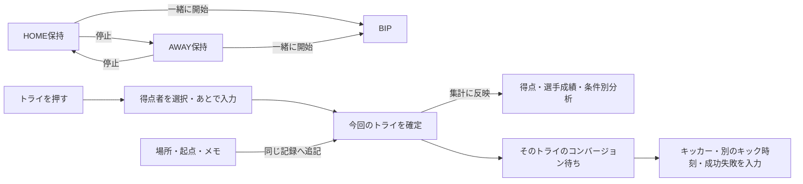

# カスタマイズ記録・分析ボードの設計図

更新：2026-09-20／状態：設計検討中・トライからコンバージョンの流れを優先

対象は、トライ・保持・選手・場所などを押して記録し、その結果を分析するカスタムボード。
今回の成果物は設計書。以下の「案」は未実装・未確定であり、現行動作と区別する。

ユーザーの最新方針：まず考えを整理し、すぐにコードを書き換えない。
最初の検討対象は「トライ → トライ者入力 → コンバージョンの選手・成功／失敗」。
詳細は [トライ・コンバージョン設計書](TRY_CONVERSION_DESIGN.md) にまとめ、今後の相談で更新する。
各画面の配置とボタンの役割は [画面とボタンの具体案](TRY_CONVERSION_SCREENS.md) を参照。

## 1. 作り方

1. 分析で知りたいことを決める。例：「誰が、どこから、どの起点でトライしたか」。
2. そのために必要な記録と、入力する順番を決める。
3. 関係するボタンを小さなまとまりに分け、各ボタンの仕様カードを書く。
4. 具体的な試合場面を使って、通常操作・間違い・取り消しを確認する。
5. 動く試作品でタップ数と見やすさを確認し、そのまとまりを実装・検証する。
6. 使った感想を反映してから、次のまとまりへ進む。

「ボタンを1つずつ考える」ときも、保持とBIPのように一緒に動くものは同じ段階で確認する。
色や配置を変えても、何を記録し、何を集計するかは変わらない設計にする。

## 2. 現在できることと、これから設計すること

| 項目 | 現行コードで確認した動作 | 設計を詰める部分 |
| --- | --- | --- |
| 見た目 | 色・アイコン・形・サイズ・配置・名前を変更可能 | 状態の見分けやすさ、押しやすさ、連動相手の表示 |
| 保持と時計 | HOME/AWAY切替、BIP開始、時計との連動あり | 同じボタンの再タップ、BIP単独、停止と再開の意味を明文化 |
| カスタム標準の得点4ボタン | トライ・コンバージョン・PG・DGは回数ボタン。タップで成功として記録 | 従来画面の選手選択・成功失敗入力を、カスタムでも一連の操作として用意 |
| 選手・場所など | 同じチームの直前の記録に追記できる | 「今回のトライ」など追記先を固定し、別のプレーへの誤付けを防ぐ |
| 攻撃の起点 | カスタム標準では直前のプレーへ追記 | 従来画面の「次の攻撃に予約」「開始直後の保持へ後付け」「トライに引継ぎ」をどう再現するか |
| ボタンの連動 | 回数・保持・自動終了タイマー間で、一緒に開始／停止／どちらか一方 | 次の入力を開く、成功時だけ動く、関連する別の記録を作る、といった流れ |
| 分析 | 指標・チーム・選手・場所などの条件で集計可能 | 各ボタンの入力がどの集計に使われるか、分母・未入力の扱いを明示 |

特に、現行の「直前の記録に追加する」は「直前のトライに追加する」と同じ意味ではない。
トライの後に別のプレーを記録すると、そちらが追記対象になる場合がある。

## 3. ボタン同士の関係は6種類に分ける

| 関係 | 例 | 決めること |
| --- | --- | --- |
| 一緒に開始 | HOME保持 → BIP開始 | 開始済みなら重複させない |
| 相手を停止 | HOME保持 → AWAY保持停止 | 同じ瞬間に切り替え、時間の重複を作らない |
| 次の入力へ進む | トライ → 得点者を選ぶ | 自動表示／あとで入力、戻る場合の扱い |
| 同じ記録に追加 | 今回のトライ ← 得点者・場所・起点 | 追記先を画面に表示し、対象を途中で変えない |
| 関連する別の記録 | トライ → コンバージョン | 別々に保存し、対応するトライと結び付ける |
| 結果を表示 | トライ記録 → スコア・選手成績 | 表示するだけで記録を増やさない |

「一緒に開始」の矢印だけで、選手入力やコンバージョンまで表現しない。
設定画面でも「同時に動く」「次に入力する」「この記録に追加する」を読み分けられるようにする。

保持側の図は現行の主要動作。得点側の一連の流れはユーザーの希望であり、待機・時刻・画面の詳細は検討中。認定トライの分岐は詳細設計書を参照。

## 4. 1つのボタンに作る「仕様カード」

| 項目 | 記入する内容 |
| --- | --- |
| 名前・目的 | 何を記録し、どの分析に使うか |
| 対象 | HOME／AWAY／選択チーム。押した後のチーム切替で対象を変えるか |
| 押した直後 | 新規記録、計測開始・停止、入力欄を開く、表示だけ、のどれか |
| 追加入力 | 選手、成否、種類、場所、数値など。必須／任意／あとで入力 |
| 他のボタンとの関係 | 開始・停止する相手、次に開く入力、追記先 |
| 保存内容と時点 | 押した時刻／入力を終えた時刻、何件の記録になるか |
| キャンセル・取り消し | 入力を閉じた場合と、確定済みの操作を戻す場合を区別 |
| 集計 | 回数、成功率、平均、保持率など。分母と未入力の扱い |
| 見た目・配置 | 通常、選択中、計測中、未入力、押せない状態。色・文言・アイコン |
| 完了の確認 | 正常操作、再タップ、誤操作、保存失敗、再起動後の具体例 |

各カードには「決定済み」「案」「未決定」を付ける。
実装に入る前に未決定項目を数個に絞り、実装後に実際の操作で再確認する。

## 5. 維持する土台：従来のHOME保持・AWAY保持・BIP・試合時計

ユーザー方針：従来の4つのボタンの関係を維持する。基準は従来記録画面 `V3RecordingView.swift` の実装。カスタム画面側の差異を新しい基準として採用しない。

| 操作 | HOME保持 | AWAY保持 | BIP | 試合時計 | 補足 |
| --- | --- | --- | --- | --- | --- |
| 停止中のHOMEを押す | 開始 | 停止 | 開始／継続 | 開始／継続 | 記録対象もHOMEへ切替 |
| 停止中のAWAYを押す | 停止 | 開始 | 開始／継続 | 開始／継続 | 記録対象もAWAYへ切替 |
| 計測中のHOMEをもう一度押す | 停止 | 停止のまま | 継続 | 継続 | HOME保持だけを止める |
| 計測中のAWAYをもう一度押す | 停止のまま | 停止 | 継続 | 継続 | AWAY保持だけを止める |
| 時計動作中に停止中のBIPを押す | 停止のまま | 停止のまま | 開始 | 継続 | 保持側を自動選択しない |
| 時計停止中にBIPを押す | 変化なし | 変化なし | 開始不可 | 停止のまま | 従来はボタンが無効 |
| 計測中のBIPを押す | 停止 | 停止 | 停止 | 継続 | 試合時計は止めない |
| 試合時計を停止 | 停止 | 停止 | 停止 | 停止 | その時点までの各区間を保存 |
| 試合時計を開始／再開 | 停止のまま | 停止のまま | 停止のまま | 開始／再開 | 保持・BIPは自動再開しない |

「停止」は累計を0にする意味ではない。HOMEとAWAYの保持は同時に計測しない。BIPだけが動いている状態は可能。
HOME/AWAY保持の開始時には、予約済みの攻撃の起点をその保持区間へ引き継ぐ現行動作も保持する。

カスタム画面の現行実装では、時計停止中でもBIP操作が試合時計を開始する差がある。前回の操作見本もこの差を含んでおり、従来仕様の正確な再現ではなかった。今後の画面案・実装は上表へ合わせる。
入力中にHOME/AWAY/BIPを表示専用にする画面提案も撤回し、従来の計測操作を維持する。入力対象のトライは、別の計測操作で記録対象チームを切り替えても元のチーム・時刻に固定する。

### 今回追加するトライとの関係

- トライを押した瞬間にBIP・両保持を停止。試合時計は継続。
- トライ入力を誤タップとして取り消したときだけ、元の計測を復元する。
- 判定でトライなしとなった場合や認定トライへの変更では、計測を自動再開しない。
- 間に別の計測操作が入った場合、古い状態で現在を上書きせず区間の補正を扱う。詳細な訂正画面は別途設計する。

保持率など分析上の分母・表示名は、ここで確定したボタン関係とは分けて検討する。

### 操作確認の例

1. 試合時計00:00でHOME保持を開始。
2. 00:10でAWAY保持へ切替。
3. 00:15でBIPを停止。
4. 00:20で試合時計を停止。

期待値：HOME10秒、AWAY5秒、BIP15秒、試合時計20秒。
切替の瞬間は二重計測しない。BIP停止後の5秒を保持時間に入れない。
さらに「同じ保持を再タップ」「BIPだけ開始」「停止・再開」「後半へ移行」「取り消し」「保存失敗」を確認する。
取り消し時に戻す時計・区間と、その後に経過した時間の扱いは実装前に決める。

## 6. 今回の検討対象：トライ → トライ者 → コンバージョン

ユーザーの希望として、従来画面と同様にトライを押した後でトライ者を設定し、
そのトライのコンバージョンの選手・成功／失敗までを一連の流れにする。
独立したコンバージョンカードだけに頼る操作は見直す。

[トライ・コンバージョン設計書](TRY_CONVERSION_DESIGN.md) を、この部分の詳細な検討先とする。

| 検討点 | 現時点の案・位置付け |
| --- | --- |
| トライ後の選手設定 | ユーザーの希望。入力を開いた時点のチーム・トライ時刻を控える案 |
| キックまでの待ち時間 | トライは確定し、「コンバージョン／キック待機中」を残して折りたためる案 |
| キッカー・成否の入力 | 待機中に先に選択、分からなければ成否確定後、最後まで不明なら試合後に訂正【決定】 |
| 入力の確定 | トライは「確定してコンバージョンへ」で保存。コンバージョンは同一画面で時刻を記録し、成功／失敗を押すと直接確定【最新指示】 |
| キック時刻 | A方式：蹴った瞬間に「キック時刻を記録」で控え、その後に成否を選択・確定【決定】 |
| 認定トライ | 誤タップしにくい入口とし、通常トライ確定後も通常トライを取り消して変更可能【決定】。入口・確認画面は提案段階 |
| 独立カードの扱い | 完全廃止は未決定。残すなら未処理トライのキック入力を開く入口にする案 |
| 保持・BIP・時計 | トライ押下時にBIPを全て解除【決定】。BIP・両保持を停止し累計は残すと整理。試合時計は継続し必要時に手動停止。誤タップ取消だけ元の計測へ戻し、判定による無効では停止を維持【決定】 |
| 旧レイアウト | 最終的にオリジナル作成できる新レイアウトへ完全移行【方針決定】。旧配置の再現を優先しない |

トライ時の保持・BIP停止とコンバージョンへの誘導は、現行コードでは自動連動していない。
現行動作を変更する実装は、設計内容を整理した後の段階とする。

## 7. その後に進める順番

| 順番 | まとまり | 1つずつ決める内容 |
| --- | --- | --- |
| 1 | トライ・トライ者・コンバージョン・認定トライ | 今回の優先対象。入力順、待機、個別の時刻、成否、得点、関連記録 |
| 2 | 試合時計・HOME保持・AWAY保持・BIP | 開始、停止、切替、再開、後半、終了。1との関係を確認 |
| 3 | 選手・場所・起点・メモ | どの記録への追記か、未入力、訂正。1で検討した追記の仕組みを共通化 |
| 4 | ラインアウト・スクラム | 自／相手ボール、成否、場所。勝敗と保持切替を自動連動させる条件 |
| 5 | タックル・ターンオーバー・ラック | 成否・選手・関与者・保持変化。1つのプレーを重複カウントしない関係 |
| 6 | キャリー・キック・距離・時間・フェーズ | 数値・単位、親のプレー、負数、未入力、入力手数 |
| 7 | PG・DG・反則・カード・リスタート | トライに紐付かない得点、反則の主体、種類、選手、次の再開 |
| 8 | 成功率・選手成績・映像・分析結果カード | 集計元、分母、条件、記録なしの表示、押したら開く詳細 |

各段階で、表示結果まで確認してから次に進む。条件を組み合わせた分析も、対応する記録が整った段階で確認する。
例：「前半・HOME・右側のトライ・7番」の条件が、入力した1件を正しく拾うか。
全指標に複雑な入力を強制せず、必要な項目を選んで使えるようにする。

## 8. 1画面と軽さを守る共通ルール案

- 通常の記録ボードは1画面で使える構成を基本にする。追加入力は必要時だけボード内または重ねた入力欄に出し、完了すると同じ位置へ戻す。
- 選手数などで収まりきらない情報は追加入力側で扱い、ボード全体を常時縦長にしない。iPhoneの小さい画面・大きな文字でも押せるか確認する。
- 情報を増やしても主要な操作を極端に小さくしない。カードが収まらない場合は編集時に分かるようにする。
- 「計測中」「次は選手」「選手未設定」などを文言・形でも表し、色だけで状態を区別しない。
- 見た目の変更やカード削除で、過去の記録・得点・集計対象を変えない。同じ指標のカードを複数置いても集計を重複させない。
- 既存データから分からない選手・場所・関連トライを推測で埋めない。従来の操作を変えるときは移行方法を決める。
- 時計更新のたびに全記録を集計しない。ボタン連動は操作があったときだけ処理し、画像・重い読み込みは画面操作を妨げない。
- 保存失敗なら成功表示で閉じず、入力を保持する。取り消しでは、その操作が発生させた変更をまとめて扱う。

## 9. 実装時に見る場所

- `Rugby AS/RecordingWidgetCore.swift`：ボタンの定義、標準構成、現在の開始・停止ルール。
- `Rugby AS/RecordingWidgetStore.swift`：記録保存、タイマー、追記先、取り消し。
- `Rugby AS/RecordingBoardViews.swift`：カスタムボードを押したときの動作。
- `Rugby AS/RecordingLayoutEditor.swift`：見た目・入力設定・連動の編集。
- `Rugby AS/RecordingEventViews.swift`：選手・場所・種類などの追加入力。
- `V3RecordingView.swift`：従来の得点入力・保持操作の比較元。

実装上は、現在の開始・停止ルールに「入力画面を開く」を混ぜ込む前に、
入力途中の状態と確定した記録を分け、追記先の記録を識別できる土台を用意する。
ボタンごとの例外を増やすより、先に作ったトライの入力手順を他の指標でも使える形に育てる。
