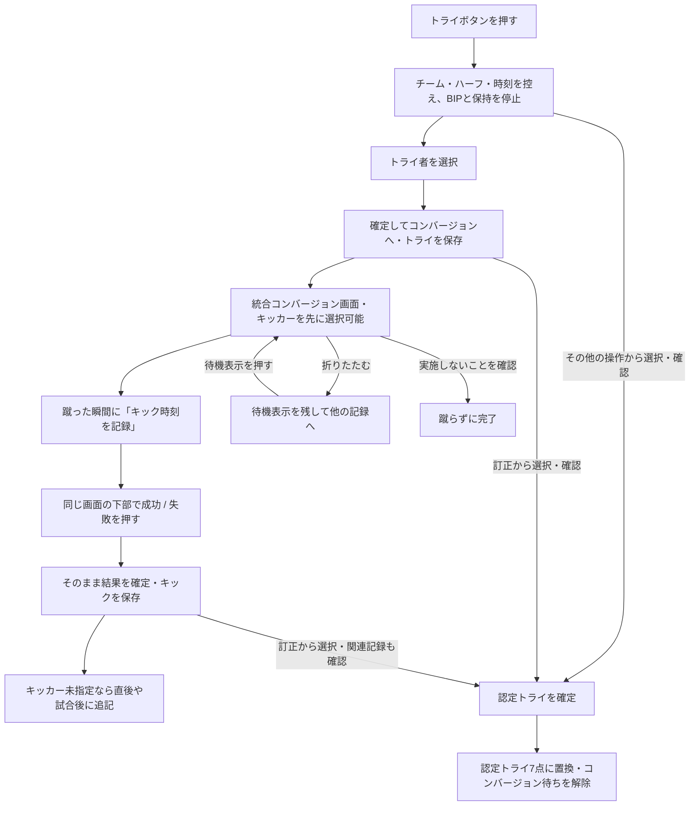

# トライからコンバージョンまでの記録設計

更新：2026-09-20／第3案・コンバージョン画面統合を反映／実装前

今回は設計書のみを作成・更新する。アプリのコード変更や実装は行わず、以下の未決事項を相談する。
ボタンの配置・文言・画面内の切り替えは [画面とボタンの具体案](TRY_CONVERSION_SCREENS.md) にまとめる。動作の決定事項と、新しい画面の提案を分けて確認する。
「認定トライ」は、この設計書ではペナルティトライを指す。映像判定などで通常のトライが認められた場合とは区別する。

## 1. 今回の希望として確定した方針

- 従来の記録画面と同じように、トライボタンを押した後にトライ者を設定できるようにする。
- 「トライ → トライ者入力 → コンバージョンの選手・成功／失敗」を一連の流れにする。
- コンバージョンは、対応するトライから続けて入力する導線を中心にする。
- トライからキックまでの待ち時間を扱い、それぞれの時刻を正しく指定できるようにする。
- 認定トライの扱いも、この流れの中で設計する。

### 第8節への回答として決定した内容

| 回答 | 決定事項 |
| --- | --- |
| 1 → A | 蹴った瞬間に「キック時刻を記録」で時刻を控え、その後に成功／失敗を選ぶ |
| 2 → 確定操作（最新指示で更新） | トライは「確定してコンバージョンへ」で保存。コンバージョンは時刻記録後に成功／失敗を押すと直接確定し、別の確定ボタンは置かない |
| 3 → キッカーの入力時点 | 待機中に先に選べる。分からなければ成功／失敗で確定した後に追記できる。それでも不明なら選手未指定で確定し、試合後に修正できる |
| 4 → BIPの解除 | トライボタンを押した瞬間にBIPを全て解除する。トライ者の選択・確定までは待たない |
| 5 → 認定トライ | 誤タップしにくい入口にする。通常トライを確定した後にも、通常トライを取り消して認定トライへ変更できる |
| 6 → レイアウト移行 | 最終的にはオリジナル作成できる新レイアウトへ完全移行する。旧レイアウトの操作・配置の再現を優先しない |

「BIPを全て解除」は、BIPおよびHOME/AWAY保持の計測中状態を解除し、押した瞬間までの累計は保存する意味として整理する。累計を0にする操作にはしない。
追加回答により、試合時計は継続して必要なときに手動停止すること、誤タップの取消だけBIP・保持を元の計測へ戻すことも決定した。判定によるトライ無効では停止を維持する。

以降、上表の動作は決定事項。具体的な配置・文言や、明記した未決事項は相談用の案。
旧レイアウトとの見た目の互換性と、保存済み試合データの維持は別に扱う。今回の回答を過去の試合記録を削除する指示とは扱わない。

### 従来の計測ボタンとの関係を維持

HOME保持・AWAY保持・BIP・試合時計の既存の連動は従来画面を基準に維持する。時計停止中のBIP単独開始は不可。トライ入力を追加することで既存の計測ボタンを表示専用にしたり、開始／停止の関係を変えたりしない。詳細は [全体設計の関係表](CUSTOM_RECORDING_DESIGN.md) を参照。

## 2. 決定した流れと画面遷移の案



通常トライ5点・コンバージョン2点・認定トライ7点、認定トライではコンバージョンを行わないことは、World Rugby第8条8.1・8.3に基づく。コンバージョンを辞退できることは8.7に基づく。[競技規則 第8条](https://passport.world.rugby/laws-of-the-game/laws-by-number/8-scoring/)

画面上は1つの流れにするが、トライとキックは別の出来事として記録する。
トライはキックを待たずに確定し、キックには「どのトライに対するものか」を保持する。
キッカーはトライ者とは別に選び、トライ者を自動でキッカーにしない。

## 3. トライを押してからトライ者を設定するまで

| 操作・状態 | 動作と検討状況 |
| --- | --- |
| トライを押す | 押した時点のチーム・ハーフ・試合時刻を控える。同時にBIP・HOME保持・AWAY保持を停止し、それまでの時間を残す |
| トライ者の入力 | そのチームの選手を背番号・写真・名前で表示する。時刻・チームも見えるようにする |
| 選手不明 | 「選手未指定」を明示的に選べる。トライ自体は記録できる |
| トライ確定 | 「確定してコンバージョンへ」で保存して5点反映し、そのトライの統合コンバージョン画面へ進む |
| 入力をやめる | 未確定なら「トライ入力をキャンセル」。トライ・得点・キック待ちを作らない。誤タップの取消ならBIP・保持を元の計測へ戻す。判定による無効なら停止を維持する【決定】 |
| 入力の確定方法 | 確定ボタンを使用する。得点者を選択しただけではトライを保存しない【決定】 |

選手選択のために時間が経過しても、トライ時刻は選手を選んだ時刻へ置き換えない。
押し遅れや判定待ちがあった場合に備え、トライ時刻は編集可能にする案。
トライ時刻を後から修正したときに保持区間の終了時刻も修正するかは、詳細設計で扱う。黙って別の区間まで変更しない。

## 4. 待ち時間を扱う画面の案

トライ確定後は、同じボード上の入力欄をコンバージョン用に切り替える。
キックまで待つ間は小さく折りたためるようにし、通常の記録操作を続けられるようにする案。
待機中にキッカーを先に選択できる。分からなくても、キック時刻の記録や成否選択を妨げない。

```text
コンバージョン／キック待機中
HOME ／ 前半03:15のトライ ／ 7番

キッカー：未指定 ［キッカーを選択］  ※試合後も編集可
キック時刻：未指定     ［キック時刻を記録］

結果：［成功］［失敗］
［折りたたむ］ ※成功／失敗を押すと直接確定
その他：実施しない／時刻を修正
```

②キック待機と③結果入力を同じ画面に統合する【決定】。「キック時刻を記録」の下に成功／失敗を常設し、時刻記録後に押すと直接確定する。追加の結果確定ボタンは置かない。時刻記録前は成否ボタンを無効にする案。
選択済みのキッカーは成否確定後にも変更でき、確定後の試合後訂正にも対応する。

- 折りたたむと「HOME 03:15のトライ → コンバージョン待ち」のような表示を残す。
- 待機表示は、成功・失敗・実施しない等を確定するまで残す。成功／失敗を押すと完了にする。時間経過だけでも完了扱いにしない。
- キッカーが最後まで不明なら「選手未指定」で確定できる。キック自体は完了とし、試合後に選手未指定の記録から訂正する。キック待ちと選手未指定を区別する。
- 選手の後日訂正では、既存キックに選手を付ける。新たなキックや得点を作らず、キック時刻も変えない。
- 「折りたたむ」は後回し。「実施しない」は実際に蹴らないことの記録。両者を分ける。
- アプリを閉じても、確定したトライと未完了のキック入力を再開できるようにする案。
- 別のプレーや別チームの記録を追加しても、追記先は元のトライから変えない。
- 未処理が複数あるときはチーム・ハーフ・トライ時刻で選択する。最新のトライへ黙って付け替えない。

独立したコンバージョンカードを残す場合は、「未処理のトライを開く」入口にする案。
押すだけで成功・得点を追加する動作にはしない。旧カードの配置・独立した操作の再現は優先せず、新レイアウトで一連の操作を完成させる。

## 5. 時刻の指定：Aを採用【決定】

**トライ時刻・キック時刻・入力を確定した時刻を分ける。**

1. トライを押した瞬間の時刻を控え、BIP・保持を停止する。
2. 選手を選び、確定ボタンを押す。選択・確定でトライ時刻を変えない。
3. キック待ちの間にキッカーを選べる。未設定のまま次へ進める。
4. 蹴った瞬間に「キック時刻を記録」を押し、キック時刻を控える。この操作だけでは成功・失敗や得点を確定しない。
5. 同じ画面の下の成功／失敗を押す。その操作で結果を保存・確定する。キッカー未指定でも確定できる。
6. キッカーが未指定なら、結果確定直後または試合後に同じ記録へ追記する。結果の確定や選手の追記でキック時刻を置き換えない。

成否を押した時刻をキック時刻にするB案は採用しない。
時刻はハーフとセットで扱う。トライ時はBIP・保持を停止し、試合時計は継続する。時計を止める必要がある場合は手動停止する【決定】。
「キック時刻を記録」は記録後「キック時刻を更新」と表示し、結果確定前は何度でも、その時点の試合時計で更新できる。成功／失敗を押すと最後に記録した時刻で確定する。専用の時刻修正による直接入力も残す。
時刻を押し忘れた場合は、その他の操作からキック時刻を手動入力する案。正確な時刻が不明なら要確認として扱い、トライ時刻や固定の経過秒数で埋めない。

### 具体例

以下は、決定した仕様に沿って試合時計を継続した場合の例。

| 出来事 | 実際の操作 | 保存する時刻の案 |
| --- | --- | --- |
| トライ | 前半03:15にトライを押す | トライ：前半03:15 |
| トライ者の設定 | 03:20に7番を選択・確定 | トライ時刻は03:15のまま |
| コンバージョンを蹴る | 04:02に「キック時刻を記録」を押す | キック：前半04:02 |
| 結果の入力 | 04:05に成功を押す | キック時刻は04:02のまま成功1件を確定し、2点加算 |
| キッカーの追記 | 04:10に記録詳細で10番を設定 | キック時刻04:02・成功・得点を維持。同じ1件の選手だけを更新 |
| 選手不明だった場合 | 選手未指定で確定し、試合後に10番へ訂正 | 同じキックの選手だけを訂正。件数・得点・キック時刻を増減しない |

映像を見ながら記録する場合は、実際のキック場面の再生位置を指定する案。
動画内の時刻と試合時計は同期設定に基づいて対応付け、編集している現在時刻と混同しない。
試合時計が停止中でも映像は進むことがあるため、同じ試合時刻の出来事でも映像位置を個別に保持する。

ハーフや試合の終了間際にトライがあった場合も、キックを入力できるようにする。通常時間を過ぎてもコンバージョンが認められる場面がある。[競技規則 第5条5.7(d)](https://passport.world.rugby/laws-of-the-game/laws-by-number/5-time/)
キックを待っている間のハーフ切替・終了で記録を消したり、キックを自動で次のハーフへ移したりしない。

## 6. 認定トライの分岐

誤タップしにくい入口にし、通常トライ確定後にも変更可能にすることは決定済み。
具体的には、通常の選手・成功失敗ボタンの並びから分けて、次の2段階にする案。

- 未確定時：「その他」→「認定トライとして記録」→変更内容を確認して確定。
- 確定後：対象トライの「訂正」→「通常トライを取り消して認定トライへ変更」→変更内容を確認して確定。

選手の位置を覚えて押した際に認定トライを誤選択しないよう、選手グリッドには並べない案。
確認画面には対象チーム・ハーフ・元のトライ時刻と「認定トライ・7点・コンバージョンなし」を表示する。
「ひとつ戻す」でトライを削除して新しく入力し直す操作に頼らず、対象の出来事を指定した訂正にする案。

| 項目 | 認定トライの設計案 |
| --- | --- |
| 記録 | 通常トライと区別できる、認定トライ1件 |
| 得点 | 対象チームに7点を反映 |
| トライ者 | 選択不要。「選手不明」とは区別して「認定トライ」と表示 |
| コンバージョン | 入力待ちを作らない。成功したキックを架空に作らない |
| 個人成績 | 誰かのトライ・キック・得点へ自動付与しない（集計方針案） |
| チームの表示 | 通常トライと認定トライを内訳表示。合計に含める範囲は名称とともに明示（集計方針案） |
| 関連する反則・カード | 必要なら別の記録として追加。反則した選手やカードを推測で入力しない |

7点とコンバージョンなしは競技規則、選手入力・個人成績・表示方法はアプリの設計案として区別する。[競技規則 第8条8.1(c)・8.3](https://passport.world.rugby/laws-of-the-game/laws-by-number/8-scoring/)

通常トライの確定後にも、通常トライを取り消して認定トライへ変更できる【決定】。
変更は元のチーム・ハーフ・トライ時刻を引き継ぎ、通常トライの5点を7点へ置き換える案。さらに7点を足さない。
通常トライとしての選手成績への加算を取り消し、コンバージョン待ちを解除する。
紐付くキックが入力済みなら、その得点・成績も含む訂正内容を表示して確認する。黙って消したり、7点とキック2点を両方残したりしない。
キック成功後に訂正した場合は「通常トライ5点＋キック2点」を「認定トライ7点」に置き換える案。チーム合計は同じでも、個人・キックの成績は訂正する。
認定トライへの変更でBIP・保持は再開しない。誤タップでの入力取消と、得点種別の訂正を区別する。
認定トライを通常トライへ訂正する場合も、選手・コンバージョンの未入力を明示する案。

## 7. 未入力・取り消し・例外を分ける

| 状態・操作 | 提案する扱い |
| --- | --- |
| トライ入力をキャンセル | 未確定のトライを破棄。得点なし。誤タップならBIP・保持を押す前から途切れず続いていた状態に戻す。判定による無効なら停止のまま【決定】 |
| 確定後、キック欄を閉じる | トライ5点を残し、コンバージョン待ちを保持 |
| コンバージョン成功 | 時刻記録後に成功を押すと、対応トライに紐付けて成功1件を確定し2点を反映 |
| コンバージョン失敗 | 時刻記録後に失敗を押すと、失敗1件を確定。追加得点なし |
| 実施しない | 辞退等の理由を記録する案。失敗や未入力と区別 |
| キッカー不明 | 待機中・成否確定後・試合後のいずれでも設定可能。結果と時刻は選手未指定で確定できる【決定】 |
| 通常トライから認定トライへ変更 | 確定後でも通常トライを取り消して変更可能【決定】。対象を選び確認して置換する案 |
| 結果不明・未入力 | 成功にも失敗にも推測で分類しない |
| キックを取り消す | キックだけ取り消し、トライを残して待機へ戻す案 |
| キック確定後にトライを取り消す | 関連キックも含めて対象を表示し、一連の記録を取り消す案。操作方法は未決定 |
| 再キック | 同じトライへの再試行として区別。最初の記録を誤って二重得点にしない。試行数の集計方針は要検討 |
| 旧データの独立したキック | 保持する。対応トライが不明なら未対応として表示し、推測で紐付けない |
| 保存失敗 | 入力を保持して再試行できるようにする。得点・待機状態だけ進めない |

通常の成功率は、結果が確定した成功／失敗を対象に計算する案。
未入力・認定トライに存在しないキック・実施しない機会を失敗として分母に入れない。
再キックや実施不可を含めた「機会数」「実際のキック数」は、通常の成功率とは別に定義する。

## 8. 回答の反映と、次の設計

最新指示を第1節に反映済み。②③の画面を統合し、成否ボタンで直接確定する。トライの確定操作、A方式の時刻記録、キッカーの後日訂正、押下時のBIP解除、認定トライへの変更、新レイアウトへの完全移行は維持する。

### 追加回答で決定した2点

1. **トライを押したときの試合時計**：BIP・保持は止め、試合時計は継続する。必要なときに手動停止する【決定】。
2. **誤タップでトライ入力をキャンセルしたときのBIP・保持**：誤タップの取消だけ、押す前から途切れず続いていた状態に戻す。判定によるトライ無効は停止のままにする【決定】。他の操作が入っていない直後の取消では、押す前の計測側・開始時刻を復元する案。

実際に他の記録・計測操作が入った後の取消は、過去の状態で現在の計測を上書きしない。対象区間をどう訂正するかは画面設計時に詰める。
認定トライへの変更は、上記の誤タップ取消とは別の操作として扱う。

### 次の画面案で詰める内容

- 確定ボタンと待機表示の具体的な配置・文言。
- トライ者自体も不明だった場合の表示、キック時刻の押し忘れ、再キック、終了間際の細部。
- 新レイアウトへの完全移行時の導線。旧画面の操作を再現することより、新画面で必要な機能が揃うことを優先する。

競技形式や大会の運用が未確認のまま、一定時間後に失敗・辞退・完了へ自動変更する仕様は設けない。
引き続き設計検討を行い、今回の回答だけを理由にコード改修へ移らない。

## 9. 設計を確認する場面

- トライを押した瞬間にBIP・HOME保持・AWAY保持が止まり、その瞬間までの累計が残る。試合時計は継続し、必要時に手動停止できる。
- 誤タップによる直後の入力取消では、BIP・保持が押す前から途切れず続いていた状態に戻る。停止中だった計測は勝手に開始しない。
- 判定によるトライ無効ではBIP・保持の停止を維持する。
- 得点者を選んだだけではトライは確定せず、「確定してコンバージョンへ」で1回だけ保存する。
- キック待機と結果入力は同じ画面。キック時刻記録後、成功／失敗を1回押すと直ちに結果が確定する。別の確定ボタンはない。
- 時刻記録前は成否を確定できず、時刻記録だけでは加点しない。
- トライ者を選ぶまで数秒かかったが、トライ時刻は変わらない。
- コンバージョンまで待つ間に別の記録を入力し、元のトライのキック入力へ戻る。
- 待機中にキッカーを先に選べる。成否確定後にも追記でき、最後まで不明なら選手未指定で確定できる。
- 試合後にキッカーを訂正しても、件数・得点・キック時刻が変わらない。
- 成功入力を連打しても、同じキックが二重に保存・加点されない。
- 認定トライは通常の選手グリッドから誤タップできず、別の入口と確認を経て確定する。
- 通常トライ確定後にも認定トライへ変更でき、元の時刻を保ち、BIPを再開せず、得点・個人成績・キック待ちを整合させる。
- 認定トライは7点で完了し、選手未指定やコンバージョン未入力の警告を残さない。
- キックを辞退した場合と、入力を後回しにした場合が見分けられる。
- アプリを閉じて再開しても、待機中のキックを正しいトライから再開できる。
- 試合終了間際のトライからコンバージョンまで、元のハーフで記録できる。
- トライ／キックの訂正や取り消しで、チーム得点と個人成績に食い違いが残らない。

これらは実装後の確認項目の案であり、今回アプリ本体のテストや改修を実施したという意味ではない。
